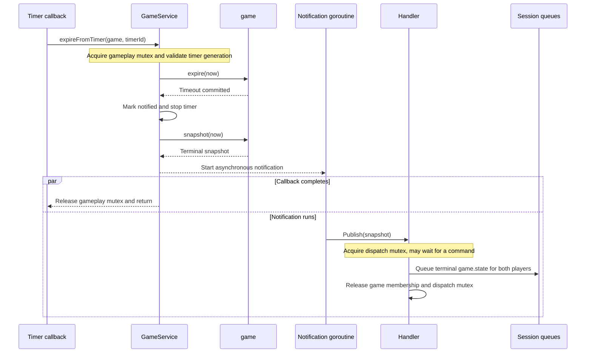

# ADR 0002: Lifecycle Ownership and Cancellation

Status: Accepted.

## Decision

`GameService` uses one mutex for games, matchmaking, timer metadata, and
notification registration. Public operations and background callbacks acquire
it; private helpers run under their caller's lock. Each `game` executes rules
synchronously, without its own mutex or goroutine.

State changes and timer replacement share a critical section. Timer generations
reject callbacks from replaced or stopped timers. Client version checks reject
stale moves. Snapshots copy state at an explicit time; commands, timer callbacks,
and `GameState` explicitly settle elapsed clocks. Timeout notification is
registered once and runs asynchronously, allowing the handler to finish its
current command before publishing the update.

Ownership and shutdown:

- `Session` owns socket I/O and heartbeat loops and joins them before returning.
- `Handler` owns command/publication ordering, membership, and matchmaking
  waiters. Its dispatch mutex covers outgoing queue acceptance, including
  [committed peer updates](0003-message-delivery-semantics.md).
- `Server` cancels connections and joins connection handlers and matchmaking
  waiters, bounded by its shutdown context.
- `GameService` owns timers and matchmaking cancellation. After application
  calls stop, `Close` stops timers and joins started notification handlers.
  Notification handlers must finish and must not call `Close` themselves.

Contexts cancel queued matchmaking and network/database I/O. Synchronous game
operations finish once dispatched; cancellation does not roll back a committed
action. Long-lived queue entries retain cancellation signals, not caller
context values.

The following shows a current timer reaching its deadline. Stale timer callbacks
return without changing the game. Callback completion and notification execution
are independent; the notification can wait for Handler's current command to finish.

## Rationale

One gameplay mutex simplifies state and timer ownership at the cost of
serializing different games. The handler already serializes WebSocket commands.
Network and database I/O stay outside gameplay operations. Revisit independent
game execution if measured contention warrants more synchronization.
